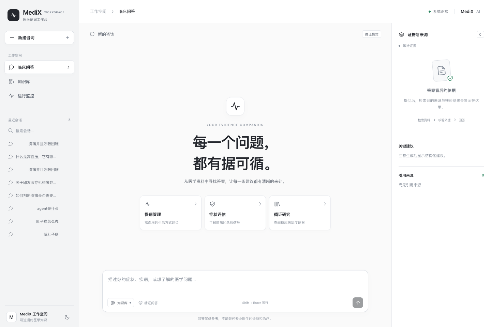
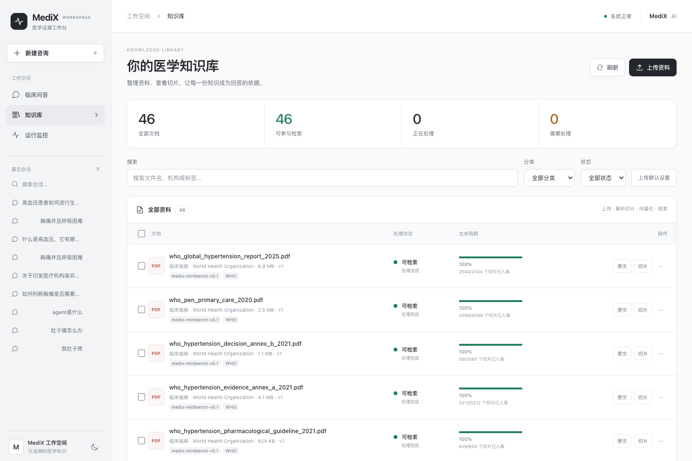
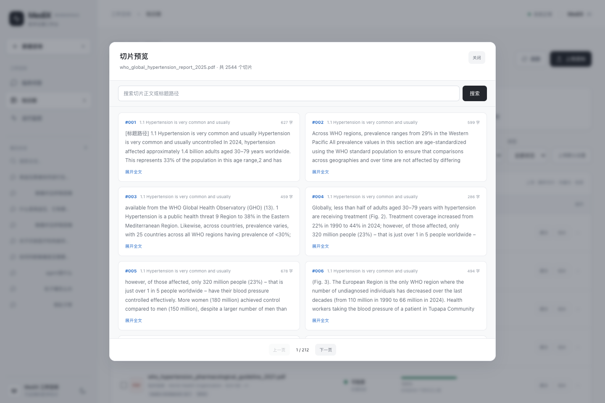
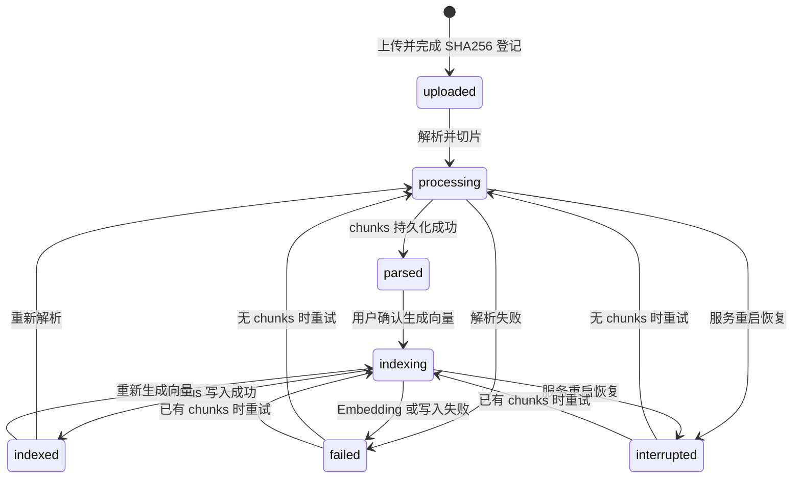
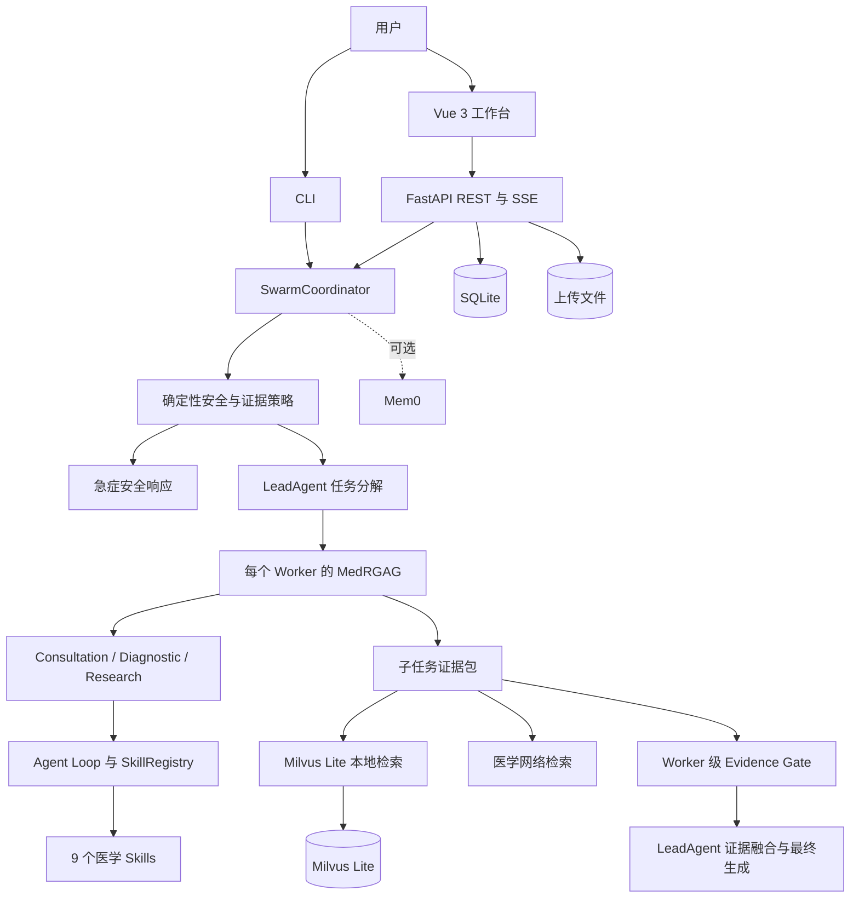
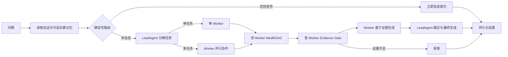
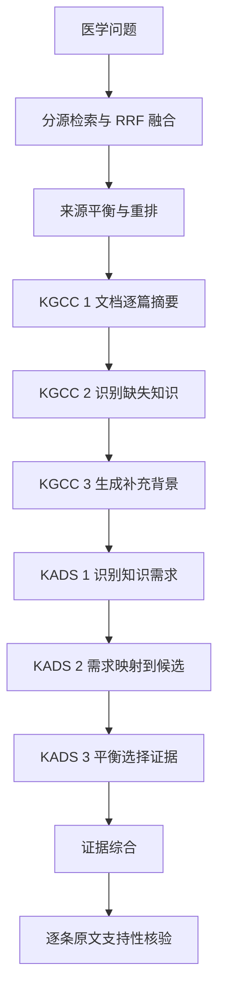

# MediX：证据优先的多智能体医学问答系统

> 把医学问答从“模型直接生成”升级为可检索、可核验、可拒答、可追溯的完整工作流。


MediX 是一个 Python、FastAPI 与 Vue 3 构建的医学 AI 应用。它将急症分流、Skills-Agent、多 Agent 协作、本地与网络证据检索、论文对齐的 KGCC/KADS 流程、引用门禁，以及可恢复的知识库生命周期整合在同一条问答链路中。

> [!CAUTION]
> MediX 仅用于医学信息检索、健康教育和研究辅助，不能替代医生诊断、处方或急救服务。出现胸痛伴呼吸困难、意识不清、大出血、卒中征象、自伤风险等情况时，应立即联系当地急救服务；中国大陆请拨打 120。

## 项目简介

普通 RAG 可以找回相关文本，却不天然保证来源权威、结论得到原文支持，也无法阻止模型把生成内容包装成引用。MediX 将“答案是否可信”拆成一组可审计的工程步骤：

- 医学事实问题强制进入证据流程，危险信号优先走急症响应。
- 本地知识库按来源类型分别检索，降低单一大语料挤占候选的风险。
- KGCC 先提取检索文档中的有效信息，再识别知识缺口并生成背景文档。
- KADS 显式识别知识需求、映射候选段落、选择互补证据。
- 生成背景只能参与推理，不能成为对外引用。
- 关键结论必须携带真实来源 ID，并通过原文支持性核验；证据不足时拒答。

当前版本定位为单机 Alpha：核心前后端、知识库生命周期和可信问答链路已经实现；认证、多租户、分布式任务队列及固定问答评分集仍在 Roadmap 中。

它主要面向需要搭建医学 RAG 原型的 AI 工程师、希望管理私有医学资料的研究人员，以及关注答案来源与拒答能力的技术评审。项目的目标不是替代临床决策，而是提供一个能观察检索、生成、核验和失败状态的工程基线。

## 界面预览

### 医学问答与证据侧栏



### 知识库工作台



### 切片检索与全文预览



前端参考 [Beautiful UI](https://github.com/slev12397/beautiful-ui) 的设计令牌和组件模式，以原生 Vue 3 与 CSS 重写，支持桌面端、移动端、明暗主题、键盘焦点管理和异常状态反馈。第三方声明见 [frontend/THIRD_PARTY_NOTICES.md](frontend/THIRD_PARTY_NOTICES.md)。

典型输入：

```text
高血压患者日常饮食和运动需要注意什么？请给出可核验来源。
```

系统不会只返回一段自由文本，还会同时给出 `citations`、`evidence_trace`、`warnings`、参与 Agent、建议和免责声明；前端将这些字段分别呈现在答案区和证据侧栏。

## 已实现能力

### 可信医学问答

- 确定性安全路由：急症、非医学操作、普通医学问题和高风险医学问题采用不同策略。
- Consultation、Diagnostic、Research 三类 Worker，由 LeadAgent 按任务复杂度选择单 Agent 或并行 Swarm。
- 医学子任务先执行 MedRGAG 与 Evidence Gate，再把通过核验的证据注入 Worker；多 Worker 模式会去重、融合各自的证据包后再生成最终回答。
- 9 个自动发现的 Skill：知识检索、临床指南、深度研究、风险评估、症状分析、ICD-10、生活方式、历史会话与相似案例。
- 本地 Milvus Lite 与医学网络来源并行检索，支持 RRF 融合、来源平衡和候选重排。
- 网络搜索优先尝试 DDGS 多后端，失败后降级到百度和 Bing HTML 搜索；每个后端受独立超时限制，避免长时间阻塞医学问答。
- 回答返回引用、原文片段、标题路径、文档/chunk 定位、检索分数、权威度、证据轨迹和警告。
- 证据缺失、引用无效、生成文档冒充来源或高风险问题缺乏权威证据时安全降级或拒答。

### 可恢复的知识库生命周期

- 支持 PDF、DOCX、XLSX、XLSM、TXT 和 Markdown。
- 上传内容真实写入 `data/uploads/`，使用随机存储名与 SHA-256 去重，元数据写入 SQLite。
- 解析与切片合并为一个用户动作；向量化是单独的显式确认步骤。
- PDF 提取正文块与表格，并清理重复页眉、页脚、页码和水印；Word、Excel、文本统一为中间表示。
- 按标题树、句子边界、表格行组和主题连贯性切分，默认上限 384 tokens、语义单元重叠最多 48 tokens。
- 向量化前使用 Embedding 模型 tokenizer 再次校验；超限块会安全重切，避免超过模型 512 token 上限。
- 原文件可在线预览或下载；切片可搜索、分页、展开全文；任务记录和失败原因可查看。
- 支持重新解析、重新向量化、失败重试和完整删除；删除同时覆盖原文件、SQLite 记录、chunks、任务与 Milvus 向量。
- 服务重启会将未完成任务标记为可见、可重试的 `interrupted`，不会伪造完成进度。

### 产品化 Web 工作台

- SSE 工作流状态、增量答案呈现、停止请求和 Markdown 渲染。
- 会话创建、搜索、重命名、删除与历史回答证据回看。
- 引用侧栏与来源详情弹窗；本地引用可定位到持久化 chunk，并打开原文件。
- 文档分类、标签、来源类型、权威级别、出版机构和许可信息维护。
- 批量解析、批量向量化、批量删除，配合真实任务进度轮询。
- 服务健康/就绪状态、知识库统计、响应式布局与明暗主题。

### 持久化与可审计状态

| 数据 | 当前事实源 | 内容 |
|---|---|---|
| 会话与回答 | SQLite | session、消息、结构化回答元数据、引用和建议 |
| 知识库控制面 | SQLite | 文档、版本、状态、任务、错误、解析 chunks、用户记忆 |
| 原始文件 | 本地文件系统 / Docker volume | 上传原文件与 MiniBench 语料 |
| 语义向量 | Milvus Lite | Embedding 与检索元数据 |
| 跨会话语义记忆 | Mem0，可选 | 按 `user_id` 保存和检索会话摘要 |
| Redis | 预留组件 | Compose 当前会启动 Redis，但主 API 的会话事实源仍为 SQLite |

## 应用场景

- **医学 RAG 工程验证**：比较切分、来源平衡、KGCC/KADS 与证据门禁对回答可信度的影响。
- **私有医学资料问答**：上传指南、药品说明书、教材和论文，在可查看原文与 chunk 的前提下进行检索问答。
- **医学研究辅助**：组合本地语料和网络来源，追踪每条结论的出处、权威度及未解决知识点。
- **多智能体系统教学**：观察 LeadAgent、专业 Worker、Skills、SharedContext 与最终融合如何协同。
- **作品集与面试演示**：展示前后端、持久化、RAG、Agent、安全门禁和异常恢复组成的完整工程闭环。

## 安装部署

### 环境要求

- Python 3.10+，Docker 镜像使用 Python 3.12
- Node.js 22+ 与 npm，仅本地构建前端时需要
- Docker Desktop 与 Docker Compose，容器方式需要
- 一个支持 OpenAI Chat Completions/Tools 语义的兼容 LLM 接口
- 首次向量化需下载 `BAAI/bge-small-zh-v1.5`，建议预留至少 4 GB 内存

### 方式一：Docker Compose，推荐

```bash
git clone git@github.com:aizhao/Medix.git
cd Medix
cp .env.example .env
```

编辑 `.env`，至少填写自己的密钥和接口地址：

```dotenv
MEDIX_LLM_API_KEY=your-api-key
MEDIX_LLM_BASE_URL=https://your-openai-compatible-endpoint/v1
MEDIX_LLM_MODEL=your-model-name
```

启动：

```bash
docker compose up --build
```

访问以下地址：

- Web 工作台：<http://localhost:8000/>
- Swagger API：<http://localhost:8000/docs>
- 存活检查：<http://localhost:8000/api/v1/health>
- 就绪检查：<http://localhost:8000/api/v1/ready>

`docker-compose.yml` 已为 SQLite、Milvus Lite、Hugging Face 缓存和 Redis 配置持久化 volume。若 Docker Hub 访问受限，项目默认使用镜像代理地址；如代理不可用，可将 Dockerfile 与 Compose 中的镜像前缀改回官方 Registry。

也可以使用启动脚本；当 `.env` 不存在时，它会先生成配置文件并提示补充密钥：

```bash
./scripts/start.sh
```

### 方式二：本地运行

```bash
git clone git@github.com:aizhao/Medix.git
cd Medix

python -m venv .venv
source .venv/bin/activate
python -m pip install --upgrade pip
python -m pip install -r requirements.txt

cp .env.example .env
# 编辑 .env，填写 MEDIX_LLM_API_KEY、MEDIX_LLM_BASE_URL 和 MEDIX_LLM_MODEL

cd frontend
npm ci
npm run build
cd ..

uvicorn backend.app:app --host 0.0.0.0 --port 8000 --reload
```

需要命令行问答时运行：

```bash
python main.py
```

### 方式三：交给 AI 编码助手安装

```text
请在本机部署 MediX：
1. 克隆 git@github.com:aizhao/Medix.git
2. 检查 Python 3.10+、Node.js 22+ 与 Docker 环境
3. 复制 .env.example 为 .env，但不要替我填写或打印任何 API Key
4. 优先使用 Docker Compose；不可用时创建 Python venv 并构建 Vue 前端
5. 启动后检查 /api/v1/health、/api/v1/ready 和 /docs
6. 运行项目测试并汇报失败项，不要删除已有数据
```

## 快速开始

### 1. 上传第一份医学文档

打开“知识库”，设置分类、来源类型和权威等级后上传文件。上传成功只表示原文件和元数据已保存，尚不能参与检索。

### 2. 解析并切片

点击“解析并切片”。系统将解析正文、标题树和表格，把 chunks 持久化到 SQLite。此时可以打开“切片”检查结构与内容。

### 3. 生成向量

确认切片质量后点击“生成向量”。任务完成并显示“可检索”后，该文档才会进入医学问答检索范围。

### 4. 发起带证据的问答

在“医学问答”输入：

```text
高血压患者日常饮食和运动需要注意什么？请给出可核验来源。
```

答案完成后，可在右侧查看证据数量、门禁状态和引用来源；点击来源可查看对应 chunk 或打开原文件。

## 知识库状态机



进度来自持久化任务阶段，而不是前端计时动画：

| 阶段 | 典型进度 | 含义 |
|---|---:|---|
| `parse_queued` | 0% | 等待进程内解析并发槽 |
| `parsing` | 10% | 读取文档和构建统一结构 |
| `chunking` | 60% | 生成并持久化逻辑切片 |
| `parsed` | 100% | 切片可预览，尚未向量化 |
| `index_queued` | 0% | 等待 Milvus Lite 单写者锁 |
| `embedding` | 10% | tokenizer 校验与 Embedding |
| `milvus_insert` | 40% | 清理旧向量并写入新向量 |
| `indexed` | 100% | 可参与检索 |
| `parse_failed` / `index_failed` | 100% | 错误码与错误信息已持久化 |

## API 使用

### 非流式问答

```bash
curl -X POST http://localhost:8000/api/v1/chat \
  -H 'Content-Type: application/json' \
  -d '{
    "message": "高血压患者日常生活需要注意什么？",
    "user_id": "demo-user",
    "enable_swarm": true
  }'
```

### SSE 问答

```bash
curl -N -X POST http://localhost:8000/api/v1/chat/stream \
  -H 'Content-Type: application/json' \
  -d '{"message":"二甲双胍有哪些常见不良反应？","user_id":"demo-user"}'
```

事件顺序为 `accepted` → `stage` → `answer_delta` → `completed`，失败时返回 `error`。当前 `answer_delta` 是 Agent 工作流完成后按片段发送，用于渐进渲染；尚不是 LLM 原生 token streaming。

### 上传、解析和索引

```bash
# 1. 上传
curl -X POST http://localhost:8000/api/v1/knowledge/upload \
  -F 'file=@knowledge/data/documents/20_guideline_hypertension.txt' \
  -F 'category=clinical_guideline' \
  -F 'source_type=internal' \
  -F 'authority_level=high'

# 2. 解析并切片
curl -X POST http://localhost:8000/api/v1/knowledge/documents/1/parse

# 3. 查看任务和切片
curl http://localhost:8000/api/v1/knowledge/documents/1/jobs
curl 'http://localhost:8000/api/v1/knowledge/documents/1/chunks/search?page=1&page_size=12'

# 4. 生成向量
curl -X POST http://localhost:8000/api/v1/knowledge/documents/1/index
```

### 主要端点

| 方法 | 路径 | 用途 |
|---|---|---|
| GET | `/api/v1/health` | 进程存活检查 |
| GET | `/api/v1/ready` | SQLite、上传目录和 LLM Key 就绪检查 |
| POST | `/api/v1/chat` | 结构化医学问答 |
| POST | `/api/v1/chat/stream` | SSE 工作流与增量答案 |
| GET/PATCH/DELETE | `/api/v1/sessions/{session_id}` | 会话读取、重命名和删除 |
| GET/POST | `/api/v1/memories` | 查询和创建用户作用域的持久化记忆 |
| PATCH/DELETE | `/api/v1/memories/{memory_id}` | 更新和软删除一条用户记忆 |
| POST | `/api/v1/knowledge/upload` | 上传和 SHA-256 去重 |
| GET/PATCH/DELETE | `/api/v1/knowledge/documents/{id}` | 文档详情、元数据更新和完整删除 |
| GET | `/api/v1/knowledge/documents/{id}/preview` | 浏览器内联预览原文件 |
| GET | `/api/v1/knowledge/documents/{id}/file` | 下载原文件 |
| POST | `/api/v1/knowledge/documents/{id}/parse` | 解析并持久化 chunks |
| POST | `/api/v1/knowledge/documents/{id}/index` | Embedding 并写入 Milvus Lite |
| POST | `/api/v1/knowledge/documents/{id}/retry` | 按持久化状态恢复失败任务 |
| GET | `/api/v1/knowledge/documents/{id}/chunks/search` | 搜索和分页查看切片 |
| GET | `/api/v1/knowledge/documents/{id}/jobs` | 查看文档任务历史 |
| GET | `/api/v1/knowledge/citations/{citation_id}` | 定位引用对应的本地 chunk |

完整请求模型和响应字段以启动后的 `/docs` 为准。

## 系统架构



| 模块 | 职责 |
|---|---|
| `backend/` | REST/SSE、知识库任务、文件服务、SQLite 持久化 |
| `swarm/` | 查询上下文、LeadAgent、Worker 并发、结果聚合 |
| `agents/` | 三类专业 Agent 与统一 Skill 注册 |
| `.claude/skills/` | 可自动发现、转成 function calling 的医学工具 |
| `research/` | 路由、网络搜索、MedRGAG、证据综合与 Evidence Gate |
| `knowledge/` | 多格式解析、语义切片、Embedding 和 Milvus Lite |
| `memory/` | SQLite 短期上下文、可选 Mem0、摘要与熵管理 |
| `constraints/` | Agent 能力、禁用行为和 Swarm 运行约束 |
| `validation/` | 输出修复与安全提示补全 |
| `frontend/` | Vue 3 聊天、证据和知识库工作台 |

## 医学问答工作流



1. API 先保存用户消息，并按 `session_id` 与 `user_id` 载入上下文。
2. `classify_query` 对急症、高风险和证据需求做确定性判断，避免由 Agent 自行决定是否检索。
3. 非急症问题进入统一 Agent 图；LeadAgent 只负责拆分与汇总，Worker 自主调用被允许的 Skill。
4. 每个 Worker 先针对自己的子任务执行独立 MedRGAG 和 Evidence Gate，再基于证据生成专业分析。
5. LeadAgent 融合多个 Worker 的证据包和分析，处理冲突后生成最终答案；全部证据不足时安全拒答。
6. API 再检查回答中的引用 ID 是否真实存在，最后连同证据轨迹、警告和免责声明写入 SQLite。

## MedRGAG、KGCC 与 KADS

实现位于 `research/medrgag.py`，KGCC 顺序与项目所参考论文的方法保持一致：



关键安全差异是“推理上下文”和“可引用来源”严格分离：KGCC 生成文档的 `source_kind` 固定为 `generated`、权威度为 0、`citation_allowed=false`。它可以帮助 KADS 补足推理视角，但不会出现在最终外部引用中。

LLM 阶段失败时，摘要和 KADS 均有确定性降级策略；降级信息写入 `evidence_trace.degraded_stages`，不会静默掩盖。

## Prompt 与 Agent 约束

- LeadAgent Prompt 负责判断最小必要 Worker 集合，不直接执行 Worker。
- Worker 的系统 Prompt、可用 Tools 和对话历史由 Agent Loop 组合。
- `constraints/agent_constraints.yaml` 定义每个 Agent 的能力、允许工具、禁止行为和输出规则。
- `constraints/swarm_constraints.yaml` 限制并行任务、超时和协作规模。
- 证据摘要、缺口探索、背景生成、KADS 选择及 claim-evidence 核验分别使用独立 Prompt，降低一个 Prompt 同时承担检索、推理和裁决的耦合。

## MiniBench 小型权威语料

项目提供可恢复下载的 `MediX MiniBench v0.1` 构建脚本，用于在不下载全量 PubMed、PMC 或 DailyMed 的情况下准备 45 份冻结语料：

| 来源 | 数量 | 类型 |
|---|---:|---|
| WHO | 5 | 临床指南 / 权威报告 |
| 中国国家卫生健康委 | 5 | 临床指南 |
| FDA / openFDA | 12 | 药品说明书 |
| PMC Open Access | 23 | 系统综述等研究文献 |

下载并登记到 SQLite：

```bash
python scripts/build_minibench_corpus.py --register
```

脚本支持断点续传，记录 URL、出版机构、许可、外部 ID、下载时间、文件大小与 SHA-256。登记后保持 `uploaded`，需要在知识库 UI 中显式解析和向量化。

离线校验已下载快照：

```bash
python scripts/build_minibench_corpus.py --verify-only
```

> [!NOTE]
> MiniBench 当前解决的是“小而可复现的评测语料”问题，还没有自带固定问题、金标准 chunk 和自动指标报告。Recall@K、MRR、引用正确率、忠实度与拒答准确率的评测 runner 仍在 Roadmap 中；README 不把单元测试或语料校验等同于模型效果评测。

更多说明见 [evals/README.md](evals/README.md)。部分 NHC 文档页面未声明通用开放内容许可，请仅在本地使用，除非已另行确认再分发权限。

## 技术栈

| 层级 | 技术 | 用途 | 选择理由 |
|---|---|---|---|
| 前端 | Vue 3、Vite、原生 CSS | 聊天、证据、知识库运营 | 依赖轻，适合快速产品化 |
| API | FastAPI、Uvicorn、Pydantic | REST、SSE、OpenAPI | 异步友好、类型清晰 |
| Agent | Python asyncio、OpenAI Tools | Agent Loop 与并行 Worker | 与现有 LLM 生态兼容 |
| LLM | OpenAI-compatible API | 路由、任务拆分、综合和核验 | 可替换供应商与模型 |
| Embedding | Sentence Transformers、BGE small zh | 中文语义向量 | 本地运行与中文检索平衡 |
| 向量存储 | Milvus Lite | 单机语义检索 | 无需独立服务，便于开发 |
| 关系存储 | SQLite | 会话、文档、任务、chunks、记忆 | 事务简单，状态易审计 |
| 长期记忆 | Mem0，可选 | 跨会话相似记忆 | 未配置时可安全关闭 |
| 文档解析 | PyMuPDF、pdfplumber、python-docx、openpyxl | 文本、标题和表格提取 | 覆盖常用办公格式 |
| 网络检索 | DDGS、httpx、BeautifulSoup | 医学网页搜索与正文抓取 | 失败时可降级到本地知识库 |
| 交付 | Docker、Docker Compose | 前后端一体化运行 | 统一 Python/Node/模型缓存环境 |

## 项目结构

```text
medix-agent-swarm/
├── .claude/skills/            # 9 个可自动发现的医学 Skill
├── agents/                    # Consultation、Diagnostic、Research Worker
├── backend/                   # FastAPI、Pydantic Schema、SQLiteStore
├── constraints/               # Agent 与 Swarm 运行约束
├── core/                      # LLMClient、AgentLoop、SkillRegistry
├── evals/                     # MiniBench 说明与未来评测工作区
├── frontend/                  # Vue 3 产品化工作台
├── knowledge/
│   ├── parser/                # PDF、Word、Excel、Text 解析器
│   ├── scripts/               # 本地批量导入
│   ├── chunking.py            # token 安全的语义切分
│   └── milvus_kb.py           # Embedding 与 Milvus Lite
├── memory/                    # SQLite 上下文、Mem0 与熵管理
├── research/                  # Web Search、MedRGAG、Evidence Gate
├── scripts/                   # 一键启动与 MiniBench 构建
├── swarm/                     # LeadAgent、Coordinator、SharedContext
├── tests/                     # API、切分、RAG、门禁和语料测试
├── validation/                # 输出自动修复
├── config.py                  # 环境变量配置入口
├── docker-compose.yml
├── Dockerfile
└── main.py                    # CLI 入口
```

## 配置说明

所有密钥只从环境变量读取。`.env` 已被 Git 忽略，请勿把真实 Key 写入源码、README、日志或截图。

| 配置项 | 必需 | 默认值 | 说明 |
|---|---|---|---|
| `MEDIX_LLM_API_KEY` | 问答必需 | 空 | OpenAI 兼容接口密钥 |
| `MEDIX_LLM_BASE_URL` | 否 | 项目默认兼容端点 | 建议在 `.env` 中显式配置 |
| `MEDIX_LLM_MODEL` | 否 | `qwen3.8-max` | 模型名，需支持项目调用方式 |
| `MEDIX_LLM_TEMPERATURE` | 否 | `0.7` | 普通生成温度；核验阶段代码内使用低温 |
| `MEDIX_LLM_MAX_TOKENS` | 否 | `8192` | 单次模型输出上限 |
| `MEM0_API_KEY` | 否 | 空 | 未设置时关闭跨会话语义记忆 |
| `MEDIX_DB_PATH` | 否 | `data/medix.db` | SQLite 文件路径 |
| `MEDIX_REDIS_URL` | 否 | `redis://localhost:6379/0` | 预留 Redis 地址；当前主 API 尚未读取该变量 |
| `MEDIX_MILVUS_DB_PATH` | 否 | `knowledge/data/milvus_lite.db` | Milvus Lite 数据路径 |
| `MEDIX_EMBEDDING_MODEL` | 否 | `BAAI/bge-small-zh-v1.5` | Embedding 模型 |
| `MEDIX_EMBEDDING_BATCH_SIZE` | 否 | `16` | Embedding 批大小，内存不足时调低 |
| `MEDIX_PARSE_CONCURRENCY` | 否 | `2` | 大文档解析并发上限 |
| `MEDIX_CHUNK_MAX_TOKENS` | 否 | `384` | 默认 chunk token 上限 |
| `MEDIX_CHUNK_OVERLAP_TOKENS` | 否 | `48` | 语义单元重叠上限 |
| `MEDIX_MIN_TOPIC_TOKENS` | 否 | `96` | 允许按主题变化切分前的最小累计长度 |
| `MEDIX_TOPIC_BOUNDARY_THRESHOLD` | 否 | `0.08` | 相邻语义单元的主题边界阈值 |
| `MEDIX_TOKENIZER_MODEL` | 否 | `BAAI/bge-small-zh-v1.5` | 解析阶段本地 token 计数器模型 |
| `MEDIX_KB_SOURCE_TYPES` | 否 | 7 类来源 | 按来源独立检索的类型列表 |
| `MEDIX_RETRIEVAL_PER_SOURCE` | 否 | `3` | 每种来源、每个查询的候选配额 |
| `MEDIX_DNS_PRIMARY` / `MEDIX_DNS_SECONDARY` / `MEDIX_DNS_FALLBACK` | 否 | `223.5.5.5` / `119.29.29.29` / `1.1.1.1` | Docker API 容器的外部 DNS；网络受限时可替换为云主机 DNS |
| `MEDIX_WEB_SEARCH_TIMEOUT` | 否 | `8` | 单个网络搜索后端超时（秒） |
| `MEDIX_MEDRGAG_TIMEOUT` | 否 | `120` | MedRGAG 证据阶段总超时（秒） |
| `MEDIX_WORKER_TIMEOUT` | 否 | `180` | Worker（含其专属 MedRGAG）总超时（秒） |
| `HTTP_PROXY` / `HTTPS_PROXY` / `ALL_PROXY` | 否 | 空 | 云主机必须经代理访问外网时配置 |
| `HF_ENDPOINT` | 否 | `https://hf-mirror.com` | Hugging Face 下载端点 |
| `HF_HOME` | 否 | 用户缓存目录 | Hugging Face 模型缓存目录；容器中固定为 `/root/.cache/huggingface` |
| `HF_HUB_DOWNLOAD_TIMEOUT` | 否 | `120` | 模型下载超时，秒 |
| `HF_HUB_ETAG_TIMEOUT` | 否 | `120` | Hugging Face 元数据请求超时，秒 |
| `NCBI_API_KEY` | 否 | 空 | MiniBench 获取 PMC 元数据时提高 NCBI 配额 |

## 测试与验证

后端测试使用标准库 `unittest`，不要求额外安装 pytest：

```bash
python -m unittest discover -s tests -v
```

当前测试覆盖：

- API 健康检查、会话持久化、SSE 事件和知识库生命周期。
- 超长文本/表格的 token 安全切分与 overlap 边界。
- RRF、来源平衡、KGCC、KADS 和生成内容不可引用约束。
- 医学问题强制检索、高风险权威来源要求和证据不足拒答。
- MiniBench 来源元数据、许可校验、内容哈希和去重。

如果日志出现 `DNSError: error resolving DNS`，先检查 Docker 容器内的域名解析：

```bash
docker compose exec api getent hosts www.google.com
docker compose exec api getent hosts html.duckduckgo.com
```

`docker-compose.yml` 已为 API 容器配置备用 DNS；如果服务器只能通过代理访问外网，在 `.env` 中填写 `HTTP_PROXY`、`HTTPS_PROXY` 和 `ALL_PROXY` 后重建容器。

前端生产构建：

```bash
cd frontend
npm ci
npm run build
```

## 性能与扩展性

- Embedding 模型和 Milvus 客户端采用进程内单例，减少重复加载。
- 解析使用 `MEDIX_PARSE_CONCURRENCY` 限流；Milvus Lite 写入使用进程级单写者锁，避免文件锁冲突。
- Worker 使用 `asyncio.wait` 保留超时前已经完成的贡献，再取消未完成任务；MedRGAG 另有独立总超时，超时后返回安全拒答而不是无依据答案。
- 网络搜索默认单后端超时 8 秒且不重复重试，依次尝试 DDGS、百度 HTML 和 Bing HTML，全部失败后降级到本地知识库。
- 大 PDF 的主要成本是解析内存、chunk 数量和 CPU Embedding；遇到退出码 137 时，应先降低解析并发与 Embedding batch，而不是并行提交更多索引任务。
- SQLite、FastAPI BackgroundTasks 与 Milvus Lite 适合本地/单机工作负载，不支持安全的多实例任务调度。
- 横向扩展需要把 BackgroundTasks 替换为持久任务队列，将 SQLite/Milvus Lite 替换为共享数据库与独立 Milvus，并把原文件迁移至对象存储。
- 网络研究依赖第三方搜索和站点可用性；失败状态会进入证据轨迹，本地知识库仍可作为降级来源。

## 安全与当前边界

已实现：

- 密钥仅从环境变量读取，`.env`、数据库、上传文件和模型缓存默认不提交 Git。
- 上传扩展名白名单、SHA-256 去重、随机存储名和下载目录边界检查。
- 会话历史按 `session_id` 读取；Mem0 与 memories API 按 `user_id` 查询；引用区分检索来源与模型生成背景。
- 急症优先分流、Agent 禁止行为、来源门禁、claim-evidence 核验和统一免责声明。
- 向量删除失败时中止文档删除，避免控制面显示已删而检索面仍残留。

尚未实现，生产使用前必须补齐：

- 登录认证、RBAC、多租户强隔离和管理员审计日志。
- 上传大小限制、内容安全扫描、速率限制和 API 配额。
- 当前 CORS 允许全部来源，适合开发环境，不适合直接暴露公网。
- SQLite 中的 `user_id` 是调用方提供的逻辑边界，不是经过认证的身份。
- Web 抓取需要进一步加强 SSRF、DNS 重绑定与出站网络策略。
- 数据加密、备份恢复、隐私脱敏和医疗合规评审。

## 项目亮点

1. **从“相关性”升级到“可支持性”**：召回之后继续做需求映射、引用授权和逐条原文支持核验。
2. **论文方法与工程安全结合**：保留 KGCC/KADS 主流程，同时禁止生成背景成为伪引用。
3. **知识库不是上传 Demo**：原文件、chunks、向量、任务、错误和重试形成持久化生命周期。
4. **可解释的失败**：超时、来源不可用、解析失败、引用不合法和证据不足均进入结构化状态。
5. **生成前证据核验**：每个医学子任务先完成 MedRGAG 和 Evidence Gate，再让 Worker 基于证据生成；LeadAgent 只融合已携带证据状态的贡献。
6. **产品与工程同步**：Vue 3 工作台覆盖会话、证据、知识库运营、移动端和无障碍交互，而不只是接口演示。

## Roadmap

- [x] FastAPI + Vue 3 全栈工作台
- [x] 单 Agent / Agent Swarm 与自动发现 Skills
- [x] 医学问题确定性证据路由与急症分流
- [x] 来源平衡检索、KGCC/KADS 与 Evidence Gate
- [x] Worker 级证据前置、超时保留部分结果与网络搜索多级降级
- [x] SQLite 会话、记忆、文档、任务和 chunks 持久化
- [x] 多格式上传、解析切片、预览、向量化、重试与删除
- [x] 45 文档 MiniBench 冻结语料构建与哈希验证
- [ ] LLM 原生 token streaming 和可取消的后端推理任务
- [ ] 固定医学问答集与 Recall@K、MRR、引用正确率、忠实度、拒答准确率报告
- [ ] 认证、RBAC、多租户、审计、限流和上传安全扫描
- [ ] 持久任务队列、对象存储、共享 SQL 数据库与独立 Milvus
- [ ] 文档 OCR、版面模型、表格质量评分和人工 chunk 审核
- [ ] 可观测性、成本追踪、Prompt/模型版本和回归评测面板

## 贡献指南

1. Fork 仓库并创建分支：`git checkout -b feature/your-feature`。
2. 保持知识库状态转换、引用来源和错误路径可审计。
3. 为新功能补充单元测试，运行后端测试和前端生产构建。
4. 不要提交 `.env`、真实密钥、患者数据、模型缓存、本地数据库或下载语料。
5. 提交 Pull Request，并说明行为变化、验证方式和安全影响。

推荐提交前运行：

```bash
python -m unittest discover -s tests -v
cd frontend && npm ci && npm run build
```

## FAQ

### 没有 LLM API Key 能启动吗？

API 和前端可以启动，`/api/v1/ready` 会显示 `degraded`；解析、切片和部分离线测试仍可使用，但 Agent 问答、KGCC/KADS 与证据核验需要 LLM。

### 为什么首次生成向量很慢？

首次运行需要下载并加载 BGE Embedding 模型。Docker 会把 Hugging Face 缓存持久化，后续启动会优先使用本地快照。

### 为什么解析完成后还不能检索？

“解析并切片”只把可检查的 chunks 保存到 SQLite；需要人工确认后再点击“生成向量”。只有 `indexed` 状态的文档才进入 Milvus 检索。

### 为什么批量向量化要串行？

Milvus Lite 的单个数据库文件不适合多个并发写入者。项目使用进程级锁串行执行索引任务，避免 `DataDirLockedError` 和重复加载模型导致的内存峰值。

### 退出码 137 怎么处理？

它通常表示容器因内存不足被终止。先把 `MEDIX_PARSE_CONCURRENCY` 调为 `1`、`MEDIX_EMBEDDING_BATCH_SIZE` 调为 `4` 或 `8`，一次只索引一份大型文档，并提高 Docker Desktop 的内存上限。

### Redis 是否保存了当前会话？

当前 Web/CLI 主路径使用 SQLite 作为会话事实源。代码保留了 Redis 短期记忆实现，Compose 也启动 Redis，但尚未把主 API 切换到 Redis。

### 能替换 LLM 或 Embedding 模型吗？

可以通过环境变量替换。LLM 需要兼容项目使用的 Chat/Tools 行为；Embedding 模型更换后向量维度可能变化，应清理并重建 Milvus collection 后重新索引全部文档。

### MiniBench 是否已经给出 RAG 分数？

没有。它目前提供小型、可冻结、可校验的权威语料，尚未提供完整金标准问题集和评分 runner。项目不会用单元测试通过率冒充检索或医学回答质量。

## License

当前仓库根目录尚未提供项目级 `LICENSE`，因此不要默认把 MediX 本身视为 MIT 或其他开源许可证。公开发布或接受外部贡献前，应由维护者选择并添加明确许可证。

前端使用的 Beautiful UI 设计模式按其 MIT 许可保留声明，详见 [frontend/THIRD_PARTY_NOTICES.md](frontend/THIRD_PARTY_NOTICES.md)。下载到本地的 MiniBench 文档仍受各自来源许可约束。
